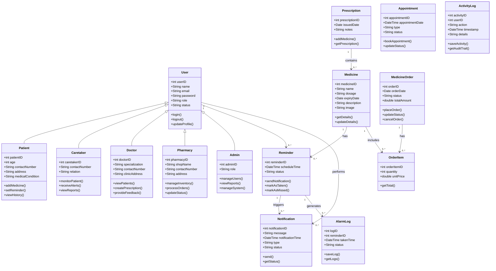
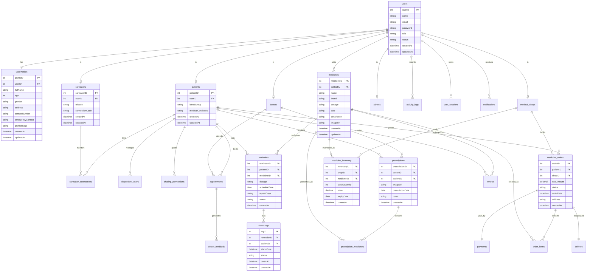
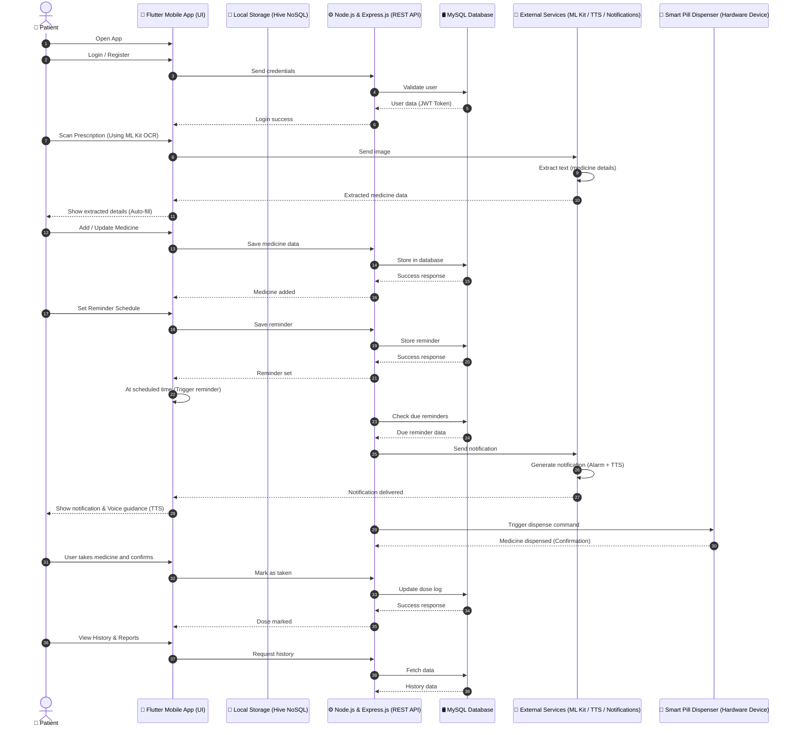
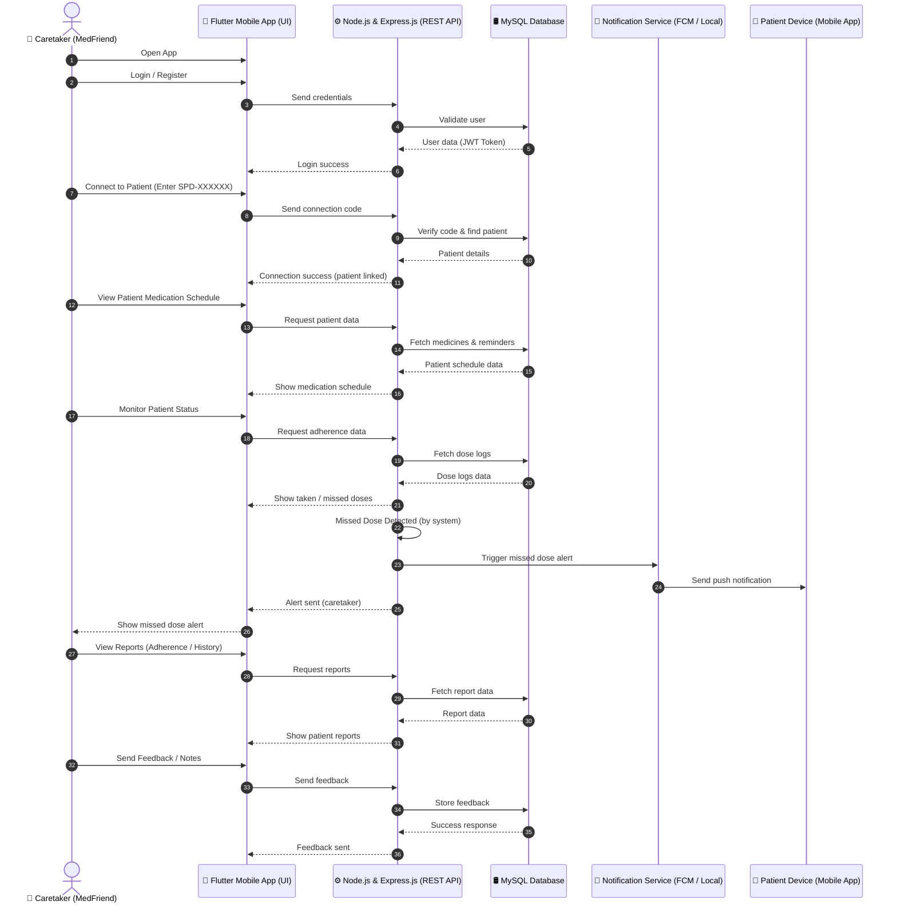
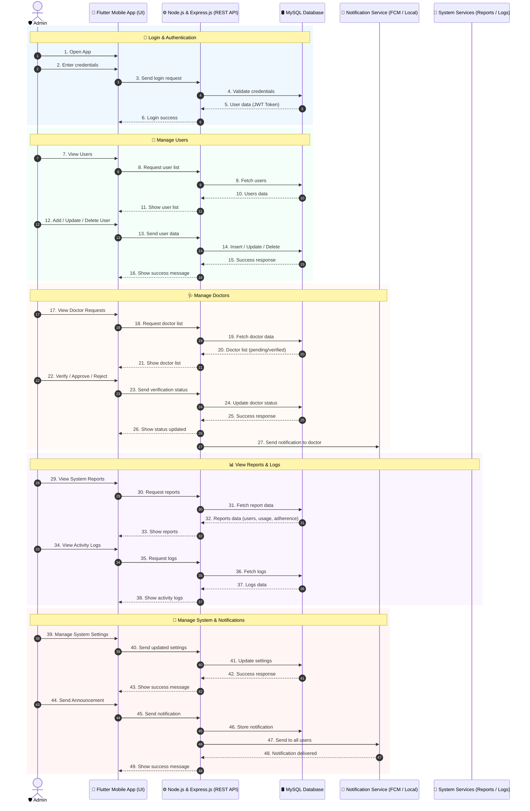
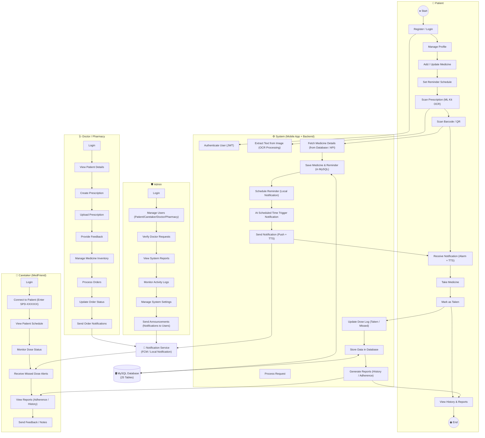

# 📐 Smart Pill Dispenser & Medicine Reminder System
## Comprehensive Prompts & Specifications for Updating Project Diagrams

> **Project Name:** Smart Pill Dispenser & Medicine Reminder System (SmartMed Reminder)  
> **Architecture:** Full-Stack Cross-Platform Healthcare Ecosystem  
> **Tech Stack:**
> - **Frontend:** Flutter 3.x (Dart), Hive NoSQL Box (Offline-First Storage), Provider State Management, `flutter_local_notifications`, `flutter_tts` (Text-to-Speech), `google_mlkit_text_recognition` (OCR), `mobile_scanner` (Barcode/QR).
> - **Backend:** Node.js & Express.js REST API, JWT Authentication, BCrypt Hashing, MySQL2 Connection Pool, Comprehensive Activity & Session Audit Trail (`activity_logs`, `user_sessions`).
> - **Database:** MySQL 8.x Relational Database with 25 Normalized Tables.
> - **Hardware & IoT:** Smart Pill Dispenser (Hardware Device) with automatic dispensing commands.
> - **5 Core User Roles:** Patient, Caretaker (MedFriend), Doctor, Pharmacy (Medical Shop), System Admin.
>
> **Target Audience:** AI Image Generators (ChatGPT Plus / DALL-E 3, Midjourney, Google Gemini Imagen), UML Diagram Tools (Mermaid.js, PlantUML), Technical Project Reports, and Architecture Documentation.

---

## 📌 Table of Contents
1. [Executive Summary: Complete System Evolution](#executive-summary)
2. [Master All-in-One Prompt (For AI Chatbots & Image Generators)](#master-all-in-one-prompt)
3. [Diagram 1: System Architecture Diagram](#diagram-1-system-architecture-diagram)
4. [Diagram 2: UML Class Diagram](#diagram-2-uml-class-diagram)
5. [Diagram 3: UML Use Case Diagram](#diagram-3-use-case-diagram)
6. [Diagram 4: Entity Relationship (ER) Diagram](#diagram-4-entity-relationship-diagram)
7. [Diagram 5: Patient Sequence Diagram (37 Steps with IoT Hardware Dispenser)](#diagram-5-patient-sequence-diagram)
8. [Diagram 6: Caretaker Sequence Diagram (36 Steps with MedFriend Telemetry)](#diagram-6-caretaker-sequence-diagram)
9. [Diagram 7: Admin Sequence Diagram (49 Steps across 5 Operational Phases)](#diagram-7-admin-sequence-diagram)
10. [Diagram 8: System Activity Diagram (5 Swimlanes Across All Stakeholders)](#diagram-8-system-activity-diagram)
11. [How to Generate & Export Updated Images](#how-to-generate--export-updated-images)

---

<a name="executive-summary"></a>
## 🚀 1. Executive Summary: Complete System Evolution

The project diagrams have evolved from a basic 3-module prototype into an **enterprise digital health, tele-pharmacy, and IoT hardware medication dispensing ecosystem**:

| Dimension | Initial Prototype Diagram | Final Updated System Diagram |
| :--- | :--- | :--- |
| **User Stakeholders** | Only 3: Patient, Caretaker, Admin | **5 Distinct Roles:** Patient, Caretaker (MedFriend), Doctor, Pharmacy (Medical Shop), System Admin |
| **Client Frontend** | Generic Mobile App | **Flutter 3.x (Dart)** with 9 integrated sub-modules, Hive NoSQL offline-first storage, Provider state management |
| **Backend & Security** | Unauthenticated direct pipe | **Node.js & Express.js REST API** with JWT tokens, BCrypt hashing, MySQL2 pooling, session & activity logging |
| **Database Schema** | Generic single database cylinder | **MySQL 8.x with 25 Normalized Relational Tables** (`users`, `userProfiles`, ISA role subtypes, `medicines`, `reminders`, `alarmLogs`, `prescriptions`, `prescription_medicines`, `medicine_inventory`, `medicine_orders`, `order_items`, `payments`, `delivery`, `reviews`, `activity_logs`, `user_sessions`) |
| **Vision & ML** | Simple Barcode API | **Google ML Kit OCR (Prescription Text Extraction & Auto-fill)** + **Mobile Scanner (Barcode & QR catalog lookup)** |
| **Accessibility** | Basic system notifications | **Flutter TTS (Text-to-Speech)** voice dosage playback + Loud audio alarms |
| **Hardware & IoT** | Not present | **Smart Pill Dispenser (Hardware Device)** with automated pill dispensing commands & dispensing confirmation |
| **Tele-Medicine & Pharmacy** | Not present | **Doctor Consultation**, Digital E-Prescriptions, **Pharmacy Inventory**, Cart checkout, order tracking (`packed` -> `delivered`) |
| **Governance & Security** | Simple admin user view | **Real-time `activity_logs` & `user_sessions`**, Doctor license verification, Caretaker code pairing (`SPD-XXXXXX`) |

---

<a name="master-all-in-one-prompt"></a>
## 🧠 2. Master All-in-One Prompt (For AI Chatbots & Image Generators)

*Copy and paste this prompt directly into ChatGPT Plus (GPT-4o), Google Gemini, or Claude to generate updated diagram images and code simultaneously:*

```text
You are an expert Enterprise Healthcare Software Architect and Technical Illustrator.
I need you to generate updated, publication-ready diagrams for our complete project:
"Smart Pill Dispenser & Medicine Reminder System (SmartMed Reminder)".

The system has been updated into an enterprise IoT digital health ecosystem:
- FRONTEND: Cross-platform Flutter 3.x Mobile App (Dart) with 9 sub-modules (User Authentication, Medicine Management, Reminder Scheduling, Prescription Scanner Google ML Kit OCR, Barcode/QR Scanner, Notifications & Alerts, Text-to-Speech TTS, Offline Storage Hive NoSQL, State Management Provider).
- BACKEND API: Node.js & Express.js REST API with 9 sub-modules (JWT & BCrypt Authentication, User Management across 5 roles, Medicine & Prescription APIs, Reminder & Notification APIs, Order & Appointment APIs, Dispensing Business Logic, Activity & Session Logging Audit Trail, MySQL2 Connection Pool, REST API Endpoints).
- DATABASE: MySQL 8.x Database with 25 Relational Tables (users, userProfiles, patients, caretakers, doctors, medical_shops, admins, dependent_users, sharing_permissions, activity_logs, user_sessions, caretaker_connections, medicines, reminders, alarmLogs, notifications, prescriptions, prescription_medicines, appointments, doctor_feedback, medicine_inventory, medicine_orders, order_items, payments, delivery, reviews).
- EXTERNAL SERVICES & HARDWARE: Google ML Kit OCR, Barcode/QR Scanner, Flutter TTS, Flutter Local Notifications, and Smart Pill Dispenser (Hardware Device) (Dispense Medicine).
- 5 USER ROLES: Patient, Caretaker (MedFriend), Doctor, Pharmacy (Medical Shop), and System Admin.

TASK:
Generate updated, high-resolution visual diagrams and updated graphical images for the following 8 core diagrams:
1. System Architecture Diagram (Flutter Frontend 9 blocks, Node.js Backend 9 blocks, MySQL 25 tables, External Services + Smart Pill Dispenser Hardware Device, 5 actors)
2. UML Class Diagram (User base class, 5 subclasses, Medicine, Prescription, Reminder, Notification, AlarmLog, MedicineOrder, OrderItem, Appointment, ActivityLog)
3. UML Use Case Diagram (5 actors, Patient & Caretaker on left, Doctor, Pharmacy, Admin on right, include/extend hubs: Authenticate User, Manage Medicines -> Smart Pill Dispense, Send Notifications -> Track Dose -> Maintain History, Manage Orders -> View Status -> Payment, Manage Appointments -> Feedback)
4. Entity Relationship (ER) Diagram (Complete 22+ entity relational model with PK/FKs, users, userProfiles, ISA hierarchy, caretaker_connections, dependent_users, sharing_permissions, activity_logs, user_sessions, medicines, reminders, alarmLogs, notifications, prescriptions, prescription_medicines, appointments, doctor_feedback, medicine_inventory, medicine_orders, order_items, payments, delivery, reviews)
5. Patient Sequence Diagram (37 Steps with Hive NoSQL, ML Kit OCR auto-fill, and Smart Pill Dispenser Hardware Device integration)
6. Caretaker Sequence Diagram (36 Steps with SPD-XXXXXX code pairing, schedule inspection, live dose monitoring, and FCM missed dose alerts)
7. Admin Sequence Diagram (49 Steps across 5 Operational Phases: Login & Auth, Manage Users, Manage Doctors, View Reports & Logs, Manage System & Notifications)
8. System Activity Diagram (5 Swimlanes: Patient, System [Mobile App + Backend], Caretaker, Doctor/Pharmacy, Admin, interfacing with MySQL Database and Notification Service)

IMAGE GENERATION INSTRUCTION:
For each diagram, please GENERATE AN UPDATED IMAGE showing a clean, modern, professional white-background blueprint with high contrast, sharp vector-like linework, legible typography, and no blurry artifacts. In addition to the generated image, provide the complete, error-free Mermaid.js code block and PlantUML code block so the diagram can be exported as SVG/PNG.
```

---

<a name="diagram-1-system-architecture-diagram"></a>
## 🏛️ 3. Diagram 1: System Architecture Diagram

### Overview & Visual Structure
- **Left Column:** 5 Actors (`Patient`, `Caretaker (MedFriend)`, `Doctor`, `Pharmacy (Medical Shop)`, `Admin`) connecting with `Uses` arrows.
- **Center-Left Container:** `Flutter Mobile Application (Frontend - Dart)` containing 9 sub-modules:
  1. *User Authentication (Login / Registration)*
  2. *Medicine Management*
  3. *Reminder Scheduling*
  4. *Prescription Scanner (Google ML Kit OCR)*
  5. *Barcode / QR Scanner*
  6. *Notifications & Alerts (Flutter Local Notifications)*
  7. *Text-to-Speech (TTS) (Voice Guidance)*
  8. *Offline Storage (Hive NoSQL)*
  9. *State Management (Provider)*
- **Middle Communication Layer:** Bidirectional arrows labeled `HTTPS (REST API)` and `JSON (JWT Token)`.
- **Center-Right Container:** `Node.js & Express.js (Backend API)` containing 9 sub-modules:
  1. *Authentication & Authorization (JWT, BCrypt)*
  2. *User Management (5 Roles)*
  3. *Medicine & Prescription APIs*
  4. *Reminder & Notification APIs*
  5. *Order & Appointment APIs*
  6. *Business Logic (Dispensing, Tracking, Reports)*
  7. *Activity & Session Logging (Audit Trail)*
  8. *MySQL2 Connection Pool*
  9. *REST API Endpoints (Patient, Caretaker, Doctor, Pharmacy, Admin)*
- **Right Container:** `SQL (Queries)` arrow to `MySQL 8.x Database (25 Relational Tables)`.
- **Bottom Integration Container:** `External Services & Hardware Integration` containing:
  - *Google ML Kit OCR (Text Recognition)*
  - *Barcode / QR Scanner (Medicine Lookup)*
  - *Flutter TTS (Voice Instructions)*
  - *Flutter Local Notifications (Alarm & Alerts)*
  - **`Smart Pill Dispenser (Hardware Device) (Dispense Medicine)`**

---

### 🎨 Prompt to Generate Updated Image (System Architecture)

```text
Generate an updated, high-resolution System Architecture diagram image for "Smart Pill Dispenser & Medicine Reminder System".

Visual Style:
- Clean white background, crisp technical blueprint style, pure vector-like lines, high contrast.
- On the left side: 5 stick figure / icon actors stacked vertically:
  * "Patient"
  * "Caretaker (MedFriend)"
  * "Doctor"
  * "Pharmacy (Medical Shop)"
  * "Admin"
  Each actor has a horizontal arrow labeled "Uses" pointing to the Flutter App box.

- Main Component 1: Large box titled "Flutter Mobile Application (Frontend - Dart)" containing 9 distinct rounded rectangles:
  [User Authentication (Login / Registration)], [Medicine Management], [Reminder Scheduling], [Prescription Scanner (Google ML Kit OCR)], [Barcode / QR Scanner], [Notifications & Alerts (Flutter Local Notifications)], [Text-to-Speech (TTS) (Voice Guidance)], [Offline Storage (Hive NoSQL)], [State Management (Provider)].

- Communication Bridge: Bidirectional arrows between Flutter App and Backend labeled:
  "HTTPS (REST API)" and "JSON (JWT Token)".

- Main Component 2: Large box titled "Node.js & Express.js (Backend API)" containing 9 distinct rounded rectangles:
  [Authentication & Authorization (JWT, BCrypt)], [User Management (5 Roles)], [Medicine & Prescription APIs], [Reminder & Notification APIs], [Order & Appointment APIs], [Business Logic (Dispensing, Tracking, Reports)], [Activity & Session Logging (Audit Trail)], [MySQL2 Connection Pool], [REST API Endpoints (Patient, Caretaker, Doctor, Pharmacy, Admin)].

- Main Component 3: Database cylinder titled "MySQL 8.x Database (25 Relational Tables)" connected to Backend via bidirectional arrow labeled "SQL (Queries)". List representative tables inside or next to cylinder: users, userProfiles, medicines, reminders, alarmLogs, caretaker_connections, dependents, doctors, medical_shops, shop_medicines, medicine_orders, prescriptions, appointments, notifications, activity_logs, user_sessions.

- Bottom Container: Wide horizontal box titled "External Services & Hardware Integration" with arrows connecting to Frontend and Backend:
  [Google ML Kit OCR (Text Recognition)], [Barcode / QR Scanner (Medicine Lookup)], [Flutter TTS (Voice Instructions)], [Flutter Local Notifications (Alarm & Alerts)], and [Smart Pill Dispenser (Hardware Device) (Dispense Medicine)].

Generate a sharp, clear, publication-quality image with legible text.
```

---

### 📊 Mermaid Code for System Architecture Diagram

```mermaid
graph LR
    subgraph ACTORS["👥 Users & Stakeholders"]
        P["👤 Patient"]
        C["👥 Caretaker (MedFriend)"]
        D["👨‍⚕️ Doctor"]
        PH["🏥 Pharmacy (Medical Shop)"]
        A["🛡️ Admin"]
    end

    subgraph FLUTTER_APP["📱 Flutter Mobile Application (Frontend - Dart)"]
        F1["🔐 User Authentication (Login/Register)"]
        F2["💊 Medicine Management"]
        F3["⏰ Reminder Scheduling"]
        F4["📷 Prescription Scanner (Google ML Kit OCR)"]
        F5["🔍 Barcode / QR Scanner"]
        F6["🔔 Notifications & Alerts (Local)"]
        F7["🔊 Text-to-Speech (TTS Voice Guidance)"]
        F8["💾 Offline Storage (Hive NoSQL)"]
        F9["🔄 State Management (Provider)"]
    end

    subgraph BACKEND_API["🛡️ Node.js & Express.js (Backend API)"]
        B1["🔑 Authentication & Authorization (JWT, BCrypt)"]
        B2["👥 User Management (5 Roles)"]
        B3["📋 Medicine & Prescription APIs"]
        B4["⏰ Reminder & Notification APIs"]
        B5["🛒 Order & Appointment APIs"]
        B6["⚙️ Business Logic (Dispensing, Tracking, Reports)"]
        B7["📝 Activity & Session Logging (Audit Trail)"]
        B8["⚡ MySQL2 Connection Pool"]
        B9["🔀 REST API Endpoints"]
    end

    subgraph DB_STORAGE["🗄️ Database Storage"]
        MYSQL[("🛢️ MySQL 8.x Database<br/>(25 Relational Tables)")]
    end

    subgraph HARDWARE_EXT["🔌 External Services & Hardware Integration"]
        H1["🧠 Google ML Kit OCR (Text Recognition)"]
        H2["🔍 Barcode / QR Scanner (Medicine Lookup)"]
        H3["🔊 Flutter TTS (Voice Instructions)"]
        H4["🔔 Flutter Local Notifications (Alarm & Alerts)"]
        H5["🤖 Smart Pill Dispenser (Hardware Device) (Dispense Medicine)"]
    end

    %% Actor Connections
    P -- "Uses" --> FLUTTER_APP
    C -- "Uses" --> FLUTTER_APP
    D -- "Uses" --> FLUTTER_APP
    PH -- "Uses" --> FLUTTER_APP
    A -- "Uses" --> FLUTTER_APP

    %% Client - Server Bridge
    FLUTTER_APP <-- "HTTPS (REST API)<br/>JSON (JWT Token)" --> BACKEND_API

    %% Server - Database Bridge
    BACKEND_API <-- "SQL (Queries)" --> MYSQL

    %% Hardware & External Service Connections
    FLUTTER_APP <--> H1
    FLUTTER_APP <--> H2
    FLUTTER_APP <--> H3
    FLUTTER_APP <--> H4
    BACKEND_API <--> H5
    FLUTTER_APP <--> H5
```



---

<a name="diagram-2-uml-class-diagram"></a>
## 📦 4. Diagram 2: UML Class Diagram

### Overview & Domain Classes
- **Base Class:** `User` (+userID: int, +name: String, +email: String, +password: String, +role: String, +status: String; +login(), +logout(), +updateProfile()).
- **Generalization Subclasses:**
  - `Patient`: +patientID: int, +age: int, +contactNumber: String, +address: String, +medicalCondition: String | +addMedicine(), +setReminder(), +viewHistory()
  - `Caretaker`: +caretakerID: int, +contactNumber: String, +relation: String | +monitorPatient(), +receiveAlerts(), +viewReports()
  - `Doctor`: +doctorID: int, +specialization: String, +contactNumber: String, +clinicAddress: String | +viewPatients(), +createPrescription(), +provideFeedback()
  - `Pharmacy`: +pharmacyID: int, +shopName: String, +contactNumber: String, +address: String | +manageInventory(), +processOrders(), +updateStatus()
  - `Admin`: +adminID: int, +role: String | +manageUsers(), +viewReports(), +manageSystem()
- **Domain Entities & Associations:**
  - `Medicine`: +medicineID: int, +name: String, +dosage: String, +expiryDate: Date, +description: String, +image: String | +getDetails(), +updateDetails()
  - `Prescription`: +prescriptionID: int, +issuedDate: Date, +notes: String | +addMedicine(), +getPrescription() (*contains 0..* Medicine*)
  - `Reminder`: +reminderID: int, +scheduleTime: DateTime, +status: String | +sendNotification(), +markAsTaken(), +markAsMissed() (*Medicine has 0..* Reminder; User has 0..* Reminder*)
  - `Notification`: +notificationID: int, +message: String, +notificationTime: DateTime, +type: String, +status: String | +send(), +getStatus() (*Reminder triggers 0..* Notification; User performs 0..* Notification*)
  - `AlarmLog`: +logID: int, +reminderID: int, +takenTime: DateTime, +status: String | +saveLog(), +getLogs() (*Reminder generates 0..* AlarmLog*)
  - `MedicineOrder`: +orderID: int, +orderDate: Date, +status: String, +totalAmount: double | +placeOrder(), +updateStatus(), +cancelOrder() (*has 0..* OrderItem*)
  - `OrderItem`: +orderItemID: int, +quantity: int, +unitPrice: double | +getTotal() (*Medicine includes 0..* OrderItem*)
  - `Appointment`: +appointmentID: int, +appointmentDate: DateTime, +type: String, +status: String | +bookAppointment(), +updateStatus()
  - `ActivityLog`: +activityID: int, +userID: int, +action: String, +timestamp: DateTime, +details: String | +saveActivity(), +getAuditTrail()

---

### 🎨 Prompt to Generate Updated Image (UML Class Diagram)

```text
Generate an updated, high-resolution UML Class Diagram image for "Smart Pill Dispenser & Medicine Reminder System (Class Diagram)".

Visual Style:
- Clean white background, standard UML 2.0 object-oriented notation, 3-section class boxes (Name, Attributes, Methods).
- Generalization: Base class 'User' in the top-center with hollow triangular inheritance arrows connecting down to 5 subclasses: 'Patient', 'Caretaker', 'Doctor', 'Pharmacy', 'Admin'.
- Associations with labeled multiplicities ('1', '0..*', '1..*') and role names ('contains', 'has', 'triggers', 'generates', 'includes', 'performs').
- Clean vector lines, crisp fonts, zero blurry text.

Classes to Render:
1. User: +userID: int, +name: String, +email: String, +password: String, +role: String, +status: String | +login(), +logout(), +updateProfile()
2. Patient (extends User): +patientID: int, +age: int, +contactNumber: String, +address: String, +medicalCondition: String | +addMedicine(), +setReminder(), +viewHistory()
3. Caretaker (extends User): +caretakerID: int, +contactNumber: String, +relation: String | +monitorPatient(), +receiveAlerts(), +viewReports()
4. Doctor (extends User): +doctorID: int, +specialization: String, +contactNumber: String, +clinicAddress: String | +viewPatients(), +createPrescription(), +provideFeedback()
5. Pharmacy (extends User): +pharmacyID: int, +shopName: String, +contactNumber: String, +address: String | +manageInventory(), +processOrders(), +updateStatus()
6. Admin (extends User): +adminID: int, +role: String | +manageUsers(), +viewReports(), +manageSystem()
7. Prescription: +prescriptionID: int, +issuedDate: Date, +notes: String | +addMedicine(), +getPrescription()
8. Medicine: +medicineID: int, +name: String, +dosage: String, +expiryDate: Date, +description: String, +image: String | +getDetails(), +updateDetails()
9. Reminder: +reminderID: int, +scheduleTime: DateTime, +status: String | +sendNotification(), +markAsTaken(), +markAsMissed()
10. Notification: +notificationID: int, +message: String, +notificationTime: DateTime, +type: String, +status: String | +send(), +getStatus()
11. AlarmLog: +logID: int, +reminderID: int, +takenTime: DateTime, +status: String | +saveLog(), +getLogs()
12. MedicineOrder: +orderID: int, +orderDate: Date, +status: String, +totalAmount: double | +placeOrder(), +updateStatus(), +cancelOrder()
13. OrderItem: +orderItemID: int, +quantity: int, +unitPrice: double | +getTotal()
14. Appointment: +appointmentID: int, +appointmentDate: DateTime, +type: String, +status: String | +bookAppointment(), +updateStatus()
15. ActivityLog: +activityID: int, +userID: int, +action: String, +timestamp: DateTime, +details: String | +saveActivity(), +getAuditTrail()

Accurately connect Prescription to Medicine ('contains' 0..*), Medicine to Reminder ('has' 0..*), Reminder to Notification ('triggers' 0..*), Reminder to AlarmLog ('generates' 0..*), Medicine to OrderItem ('includes' 0..*), MedicineOrder to OrderItem ('has' 0..*). Generate the image.
```

---

### 📊 Mermaid Code for UML Class Diagram



---

<a name="diagram-3-use-case-diagram"></a>
## 🎯 5. Diagram 3: UML Use Case Diagram

### Overview & Visual Structure
- **Boundary Box:** `Smart Pill Dispenser & Medicine Reminder System`.
- **Left Actors:** `Patient`, `Caretaker (MedFriend)`.
- **Right Actors:** `Doctor`, `Pharmacy (Medical Shop)`, `Admin`.
- **Patient Direct Use Cases:** Register, Login, Manage Profile, Add / Update Medicines, Set Reminder Schedule, Scan Prescription (OCR), Scan Barcode / QR, Receive Notifications (TTS Alerts), View Medicine History, Place Medicine Order, Book Appointment (Doctor).
- **Caretaker Direct Use Cases:** Login, Monitor Patient, Receive Missed Dose Alerts, View Reports.
- **Doctor Direct Use Cases:** Login, View Patients, Create Prescription, View Adherence Reports, Provide Feedback.
- **Pharmacy Direct Use Cases:** Login, Manage Inventory, Process Orders, Update Order Status.
- **Admin Direct Use Cases:** Login, Manage Users, View System Reports, Monitor Activity Logs, Manage System Settings.
- **Central Core Orchestration Hubs (with `<<include>>` arrows):**
  1. `Authenticate User` (included by Register & Login)
  2. `Manage Medicines` (included by Add/Update Medicines, Set Reminder Schedule, Scan Prescription OCR, Scan Barcode/QR)
     - `<<include>>` -> **`Smart Pill Dispense (Automatic)`**
  3. `Send Notifications (Alerts / TTS)` (included by Receive Notifications TTS Alerts)
     - `<<include>>` -> `Track Dose (Taken / Missed)`
     - `<<include>>` -> `Maintain History & Reports`
  4. `Manage Orders` (included by Place Medicine Order)
     - `<<include>>` -> `View Order Status`
     - `<<include>>` -> `Process Payment`
  5. `Manage Appointments` (included by Book Appointment Doctor)
     - `<<include>>` -> `View Appointment Status`
     - `<<include>>` -> `Provide Feedback`

---

### 🎨 Prompt to Generate Updated Image (UML Use Case Diagram)

```text
Generate an updated, high-resolution UML Use Case Diagram image for "Smart Pill Dispenser & Medicine Reminder System (Use Case Diagram)".

Visual Style:
- Clean white background, standard UML 2.0 notation, large system boundary rectangle titled "Smart Pill Dispenser & Medicine Reminder System".
- Left side actors: "Patient", "Caretaker (MedFriend)".
- Right side actors: "Doctor", "Pharmacy (Medical Shop)", "Admin".
- Inside the boundary:
  * Central Core Orchestration Hub Ovals aligned vertically in the center:
    1. (Authenticate User)
    2. (Manage Medicines)
    3. (Send Notifications (Alerts / TTS))
    4. (Manage Orders)
    5. (Manage Appointments)
  * Left and Right sub-ovals connected with <<include>> dashed arrows:
    - (Manage Medicines) -- <<include>> --> (Smart Pill Dispense (Automatic))
    - (Send Notifications (Alerts / TTS)) -- <<include>> --> (Track Dose (Taken / Missed))
    - (Send Notifications (Alerts / TTS)) -- <<include>> --> (Maintain History & Reports)
    - (Manage Orders) -- <<include>> --> (View Order Status)
    - (Manage Orders) -- <<include>> --> (Process Payment)
    - (Manage Appointments) -- <<include>> --> (View Appointment Status)
    - (Manage Appointments) -- <<include>> --> (Provide Feedback)
  * Patient connects to: Register, Login, Manage Profile, Add / Update Medicines, Set Reminder Schedule, Scan Prescription (OCR), Scan Barcode / QR, Receive Notifications (TTS Alerts), View Medicine History, Place Medicine Order, Book Appointment.
  * Caretaker connects to: Login, Monitor Patient, Receive Missed Dose Alerts, View Reports.
  * Doctor connects to: Login, View Patients, Create Prescription, View Adherence Reports, Provide Feedback.
  * Pharmacy connects to: Login, Manage Inventory, Process Orders, Update Order Status.
  * Admin connects to: Login, Manage Users, View System Reports, Monitor Activity Logs, Manage System Settings.

Generate a crisp, legible, professional diagram image with clear dashed <<include>> lines and labels.
```

---

### 📊 Mermaid Code for UML Use Case Diagram

```mermaid
flowchart LR
    subgraph SYSTEM["📦 Smart Pill Dispenser & Medicine Reminder System"]
        %% Core Hubs
        HUB_AUTH(["🔑 Authenticate User"])
        HUB_MEDS(["💊 Manage Medicines"])
        HUB_NOTIF(["🔔 Send Notifications (Alerts / TTS)"])
        HUB_ORDERS(["🛒 Manage Orders"])
        HUB_APPT(["🩺 Manage Appointments"])

        %% Included Sub-functions
        SUB_DISPENSE(["🤖 Smart Pill Dispense (Automatic)"])
        SUB_DOSE_TRACK(["📊 Track Dose (Taken / Missed)"])
        SUB_HISTORY(["📑 Maintain History & Reports"])
        SUB_ORDER_STATUS(["🚚 View Order Status"])
        SUB_PAYMENT(["💳 Process Payment"])
        SUB_APPT_STATUS(["📅 View Appointment Status"])
        SUB_FEEDBACK(["💬 Provide Feedback"])

        %% Patient Use Cases
        P_REG(["Register"])
        P_LOGIN(["Login"])
        P_PROFILE(["Manage Profile"])
        P_MED_CRUD(["Add / Update Medicines"])
        P_REMINDER(["Set Reminder Schedule"])
        P_SCAN_OCR(["Scan Prescription (OCR)"])
        P_SCAN_BARCODE(["Scan Barcode / QR"])
        P_RECV_NOTIF(["Receive Notifications (TTS Alerts)"])
        P_HIST(["View Medicine History"])
        P_ORDER(["Place Medicine Order"])
        P_BOOK_DOC(["Book Appointment (Doctor)"])

        %% Caretaker Use Cases
        C_LOGIN(["Login"])
        C_MONITOR(["Monitor Patient"])
        C_MISSED(["Receive Missed Dose Alerts"])
        C_REPORTS(["View Reports"])

        %% Doctor Use Cases
        D_LOGIN(["Login"])
        D_PATIENTS(["View Patients"])
        D_PRESCRIBE(["Create Prescription"])
        D_REPORTS(["View Adherence Reports"])
        D_FEEDBACK(["Provide Feedback"])

        %% Pharmacy Use Cases
        PH_LOGIN(["Login"])
        PH_INV(["Manage Inventory"])
        PH_ORDERS(["Process Orders"])
        PH_STATUS(["Update Order Status"])

        %% Admin Use Cases
        A_LOGIN(["Login"])
        A_USERS(["Manage Users"])
        A_REPORTS(["View System Reports"])
        A_LOGS(["Monitor Activity Logs"])
        A_SETTINGS(["Manage System Settings"])
    end

    %% Include Relationships
    P_REG -. "<<include>>" .-> HUB_AUTH
    P_LOGIN -. "<<include>>" .-> HUB_AUTH
    P_MED_CRUD -. "<<include>>" .-> HUB_MEDS
    P_REMINDER -. "<<include>>" .-> HUB_MEDS
    P_SCAN_OCR -. "<<include>>" .-> HUB_MEDS
    P_SCAN_BARCODE -. "<<include>>" .-> HUB_MEDS
    P_RECV_NOTIF -. "<<include>>" .-> HUB_NOTIF
    P_ORDER -. "<<include>>" .-> HUB_ORDERS
    P_BOOK_DOC -. "<<include>>" .-> HUB_APPT

    HUB_MEDS -. "<<include>>" .-> SUB_DISPENSE
    HUB_NOTIF -. "<<include>>" .-> SUB_DOSE_TRACK
    HUB_NOTIF -. "<<include>>" .-> SUB_HISTORY
    HUB_ORDERS -. "<<include>>" .-> SUB_ORDER_STATUS
    HUB_ORDERS -. "<<include>>" .-> SUB_PAYMENT
    HUB_APPT -. "<<include>>" .-> SUB_APPT_STATUS
    HUB_APPT -. "<<include>>" .-> SUB_FEEDBACK

    %% Actors
    Patient(("👤 Patient"))
    Caretaker(("👥 Caretaker (MedFriend)"))
    Doctor(("👨‍⚕️ Doctor"))
    Pharmacy(("🏥 Pharmacy (Medical Shop)"))
    Admin(("🛡️ Admin"))

    %% Associations
    Patient --- P_REG
    Patient --- P_LOGIN
    Patient --- P_PROFILE
    Patient --- P_MED_CRUD
    Patient --- P_REMINDER
    Patient --- P_SCAN_OCR
    Patient --- P_SCAN_BARCODE
    Patient --- P_RECV_NOTIF
    Patient --- P_HIST
    Patient --- P_ORDER
    Patient --- P_BOOK_DOC

    Caretaker --- C_LOGIN
    Caretaker --- C_MONITOR
    Caretaker --- C_MISSED
    Caretaker --- C_REPORTS

    Doctor --- D_LOGIN
    Doctor --- D_PATIENTS
    Doctor --- D_PRESCRIBE
    Doctor --- D_REPORTS
    Doctor --- D_FEEDBACK

    Pharmacy --- PH_LOGIN
    Pharmacy --- PH_INV
    Pharmacy --- PH_ORDERS
    Pharmacy --- PH_STATUS

    Admin --- A_LOGIN
    Admin --- A_USERS
    Admin --- A_REPORTS
    Admin --- A_LOGS
    Admin --- A_SETTINGS
```



---

<a name="diagram-4-entity-relationship-diagram"></a>
## 🗄️ 6. Diagram 4: Entity Relationship (ER) Diagram

### Overview & Relational Schema (22+ Normalized Tables)
- **Core Identity & Profiles:**
  - `users` (PK: userID; name, email, password, role, status, createdAt, updatedAt)
  - `userProfiles` (PK: profileID; FK: userID; fullName, age, gender, address, contactNumber, emergencyContact, profileImage, createdAt, updatedAt)
  - Subtype Generalization (ISA):
    - `patients` (PK: patientID; FK: userID; bloodGroup, medicalConditions, createdAt, updatedAt)
    - `caretakers` (PK: caretakerID; FK: userID; relation, connectionCode, createdAt, updatedAt)
    - `doctors` (PK: doctorID; FK: userID; specialization, licenseNumber, verificationStatus, createdAt, updatedAt)
    - `medical_shops` (PK: shopID; FK: userID; shopName, address, contactNumber, licenseNumber, verificationStatus, createdAt, updatedAt)
    - `admins` (PK: adminID; FK: userID; permissionLevel, createdAt, updatedAt)
- **Care Network & Dependents:**
  - `caretaker_connections` (PK: connectionID; FK: patientID, caretakerID; status, createdAt)
  - `dependent_users` (PK: dependentID; FK: patientID; name, relation, age, createdAt)
  - `sharing_permissions` (PK: permissionID; FK: caregiverID, patientID; accessType, createdAt)
- **Audit Trails & Sessions:**
  - `activity_logs` (PK: logID; FK: userID; action, module, ipAddress, createdAt)
  - `user_sessions` (PK: sessionID; FK: userID; loginTime, logoutTime, deviceInfo, ipAddress, createdAt)
- **Medications, Reminders & Alarms:**
  - `medicines` (PK: medicineID; FK: addedBy; name, brand, dosage, type, description, imageUrl, createdAt, updatedAt)
  - `reminders` (PK: reminderID; FK: patientID, medicineID; dosage, scheduleTime, repeatDays, status, createdAt)
  - `alarmLogs` (PK: logID; FK: reminderID, patientID; alarmTime, status, takenAt, createdAt)
  - `notifications` (PK: notificationID; FK: userID, relatedID; type, message, isRead, createdAt)
- **Prescriptions & Consultations:**
  - `prescriptions` (PK: prescriptionID; FK: doctorID, patientID; imageUrl, prescriptionDate, notes, createdAt)
  - `prescription_medicines` (PK: prescriptionMedicineID; FK: prescriptionID, medicineID; dosage, frequency, duration, createdAt)
  - `appointments` (PK: appointmentID; FK: patientID, doctorID; appointmentDate, status, notes, createdAt)
  - `doctor_feedback` (PK: feedbackID; FK: appointmentID, patientID; notes, createdAt)
- **Pharmacy, Orders & Delivery:**
  - `medicine_inventory` (PK: inventoryID; FK: shopID, medicineID; stockQuantity, price, expiryDate, createdAt)
  - `medicine_orders` (PK: orderID; FK: patientID, shopID; totalAmount, status, orderDate, address, createdAt)
  - `order_items` (PK: orderItemID; FK: orderID, medicineID; quantity, price, createdAt)
  - `payments` (PK: paymentID; FK: orderID; method, transactionID, amount, status, createdAt)
  - `delivery` (PK: deliveryID; FK: orderID; status, trackingNumber, deliveredAt, createdAt)
  - `reviews` (PK: reviewID; FK: medicineID, patientID; rating, comment, createdAt)

---

### 🎨 Prompt to Generate Updated Image (Entity Relationship Diagram)

```text
Generate an updated, high-resolution Entity Relationship Diagram (ERD) image for "Smart Pill Dispenser & Medicine Reminder System (Entity Relationship Diagram)".

Visual Style:
- Clean white background, crisp technical database schema layout, sharp rectangular table entities with column headers.
- Each table lists Primary Keys (PK) and Foreign Keys (FK) explicitly.
- Crow's foot notation or clean labeled cardinality lines ('1 to 1', '1 to N', 'N to 1').
- Inheritance / ISA triangle connector connecting base table 'users' to subtype tables: 'patients', 'caretakers', 'doctors', 'medical_shops', and 'admins'.

Entities and Key Fields to Render:
1. users [PK: userID, name, email, password, role, status, createdAt, updatedAt]
2. userProfiles [PK: profileID, FK: userID, fullName, age, gender, address, contactNumber, emergencyContact, profileImage, createdAt, updatedAt]
3. patients [PK: patientID, FK: userID, bloodGroup, medicalConditions, createdAt, updatedAt]
4. caretakers [PK: caretakerID, FK: userID, relation, connectionCode, createdAt, updatedAt]
5. doctors [PK: doctorID, FK: userID, specialization, licenseNumber, verificationStatus, createdAt, updatedAt]
6. medical_shops [PK: shopID, FK: userID, shopName, address, contactNumber, licenseNumber, verificationStatus, createdAt, updatedAt]
7. admins [PK: adminID, FK: userID, permissionLevel, createdAt, updatedAt]
8. caretaker_connections [PK: connectionID, FK: patientID, FK: caretakerID, status, createdAt]
9. dependent_users [PK: dependentID, FK: patientID, name, relation, age, createdAt]
10. sharing_permissions [PK: permissionID, FK: caregiverID, FK: patientID, accessType, createdAt]
11. activity_logs [PK: logID, FK: userID, action, module, ipAddress, createdAt]
12. user_sessions [PK: sessionID, FK: userID, loginTime, logoutTime, deviceInfo, ipAddress, createdAt]
13. medicines [PK: medicineID, FK: addedBy, name, brand, dosage, type, description, imageUrl, createdAt, updatedAt]
14. reminders [PK: reminderID, FK: patientID, FK: medicineID, dosage, scheduleTime, repeatDays, status, createdAt]
15. alarmLogs [PK: logID, FK: reminderID, FK: patientID, alarmTime, status, takenAt, createdAt]
16. notifications [PK: notificationID, FK: userID, FK: relatedID, type, message, isRead, createdAt]
17. prescriptions [PK: prescriptionID, FK: doctorID, FK: patientID, imageUrl, prescriptionDate, notes, createdAt]
18. prescription_medicines [PK: prescriptionMedicineID, FK: prescriptionID, FK: medicineID, dosage, frequency, duration, createdAt]
19. appointments [PK: appointmentID, FK: patientID, FK: doctorID, appointmentDate, status, notes, createdAt]
20. doctor_feedback [PK: feedbackID, FK: appointmentID, FK: patientID, notes, createdAt]
21. medicine_inventory [PK: inventoryID, FK: shopID, FK: medicineID, stockQuantity, price, expiryDate, createdAt]
22. medicine_orders [PK: orderID, FK: patientID, FK: shopID, totalAmount, status, orderDate, address, createdAt]
23. order_items [PK: orderItemID, FK: orderID, FK: medicineID, quantity, price, createdAt]
24. payments [PK: paymentID, FK: orderID, method, transactionID, amount, status, createdAt]
25. delivery [PK: deliveryID, FK: orderID, status, trackingNumber, deliveredAt, createdAt]
26. reviews [PK: reviewID, FK: medicineID, FK: patientID, rating, comment, createdAt]

Ensure high contrast, sharp text labels, perfectly aligned relation lines, and clean legible typography. Generate the image.
```

---

### 📊 Mermaid Code for Entity Relationship Diagram



---

<a name="diagram-5-patient-sequence-diagram"></a>
## ⏱️ 7. Diagram 5: Patient Sequence Diagram (37 Steps with IoT Hardware Dispenser)

### Overview & Lifelines
- **Lifelines:**
  1. `Patient`
  2. `Flutter Mobile App (UI)`
  3. `Local Storage (Hive NoSQL)`
  4. `Node.js & Express.js (REST API)`
  5. `MySQL Database`
  6. `External Services (ML Kit OCR / Scanner / TTS / Notifications)`
  7. `Smart Pill Dispenser (Hardware Device)`

### Chronological Steps (1 to 37):
1. Patient -> Flutter Mobile App: `1. Open App`
2. Patient -> Flutter Mobile App: `2. Login / Register`
3. Flutter Mobile App -> Node.js & Express.js: `3. Send credentials`
4. Node.js & Express.js -> MySQL Database: `4. Validate user`
5. MySQL Database --> Node.js & Express.js: `5. User data (JWT Token)`
6. Node.js & Express.js --> Flutter Mobile App: `6. Login success`
7. Patient -> Flutter Mobile App: `7. Scan Prescription (Using ML Kit OCR)`
8. Flutter Mobile App -> External Services: `8. Send image`
9. External Services -> External Services: `9. Extract text (medicine details)`
10. External Services --> Flutter Mobile App: `10. Extracted medicine data`
11. Flutter Mobile App --> Patient: `11. Show extracted details (Auto-fill)`
12. Patient -> Flutter Mobile App: `12. Add / Update Medicine`
13. Flutter Mobile App -> Node.js & Express.js: `13. Save medicine data`
14. Node.js & Express.js -> MySQL Database: `14. Store in database`
15. MySQL Database --> Node.js & Express.js: `15. Success response`
16. Node.js & Express.js --> Flutter Mobile App: `16. Medicine added`
17. Patient -> Flutter Mobile App: `17. Set Reminder Schedule`
18. Flutter Mobile App -> Node.js & Express.js: `18. Save reminder`
19. Node.js & Express.js -> MySQL Database: `19. Store reminder`
20. MySQL Database --> Node.js & Express.js: `20. Success response`
21. Node.js & Express.js --> Flutter Mobile App: `21. Reminder set`
22. Flutter Mobile App -> Flutter Mobile App: `22. At scheduled time (Trigger reminder)`
23. Node.js & Express.js -> MySQL Database: `23. Check due reminders`
24. MySQL Database --> Node.js & Express.js: `24. Due reminder data`
25. Node.js & Express.js -> External Services: `25. Send notification`
26. External Services -> External Services: `26. Generate notification (Alarm + TTS)`
27. External Services --> Flutter Mobile App: `27. Notification delivered`
28. Flutter Mobile App --> Patient: `28. Show notification & Voice guidance (TTS)`
29. Node.js & Express.js -> Smart Pill Dispenser (Hardware Device): `28. Trigger dispense command`
30. Smart Pill Dispenser (Hardware Device) --> Node.js & Express.js: `29. Medicine dispensed (Confirmation)`
31. Patient -> Flutter Mobile App: `29. User takes medicine and confirms`
32. Flutter Mobile App -> Node.js & Express.js: `30. Mark as taken`
33. Node.js & Express.js -> MySQL Database: `31. Update dose log`
34. MySQL Database --> Node.js & Express.js: `32. Success response`
35. Node.js & Express.js --> Flutter Mobile App: `33. Dose marked`
36. Patient -> Flutter Mobile App: `34. View History & Reports`
37. Flutter Mobile App -> Node.js & Express.js: `35. Request history`
38. Node.js & Express.js -> MySQL Database: `36. Fetch data`
39. MySQL Database --> Node.js & Express.js: `37. History data`

---

### 🎨 Prompt to Generate Updated Image (Patient Sequence Diagram)

```text
Generate an updated, high-resolution UML Sequence Diagram image for "Smart Pill Dispenser & Medicine Reminder System (Patient Sequence Diagram)".

Visual Style:
- Clean white background, crisp technical blueprint style, vertical dashed lifelines with rectangular activation boxes.
- 7 Lifelines from left to right:
  1. "Patient"
  2. "Flutter Mobile App (UI)"
  3. "Local Storage (Hive NoSQL)"
  4. "Node.js & Express.js (REST API)"
  5. "MySQL Database"
  6. "External Services (ML Kit OCR / Scanner / TTS / Notifications)"
  7. "Smart Pill Dispenser (Hardware Device)"
- Numbered arrows from 1 to 37 capturing authentication, ML Kit OCR scan auto-fill, medicine and reminder persistence, audio & TTS alarm triggers, automated IoT pill dispensing command to Smart Pill Dispenser Hardware Device, dose marked taken, and history reporting.

Generate a crisp, legible, professional diagram image.
```

---

### 📊 Mermaid Code for Patient Sequence Diagram



---

<a name="diagram-6-caretaker-sequence-diagram"></a>
## 👥 8. Diagram 6: Caretaker Sequence Diagram (36 Steps with MedFriend Telemetry)

### Overview & Lifelines
- **Lifelines:**
  1. `Caretaker (MedFriend)`
  2. `Flutter Mobile App (UI)`
  3. `Node.js & Express.js (REST API)`
  4. `MySQL Database`
  5. `Notification Service (FCM / Local Notification)`
  6. `Patient Device (Mobile App)`

### Chronological Steps (1 to 36):
1. `1. Open App`
2. `2. Login / Register`
3. `3. Send credentials` -> `4. Validate user` -> `5. User data (JWT Token)` -> `6. Login success`
4. `7. Connect to Patient (Enter SPD-XXXXXX)` -> `8. Send connection code` -> `9. Verify code & find patient` -> `10. Patient details` -> `11. Connection success (patient linked)`
5. `12. View Patient Medication Schedule` -> `13. Request patient data` -> `14. Fetch medicines & reminders` -> `15. Patient schedule data` -> `16. Show medication schedule`
6. `17. Monitor Patient Status` -> `18. Request adherence data` -> `19. Fetch dose logs` -> `20. Dose logs data` -> `21. Show taken / missed doses`
7. `22. Missed Dose Detected (by system)` -> `23. Trigger missed dose alert` -> `24. Send push notification (to Patient Device)` -> `25. Alert sent (caretaker)` -> `26. Show missed dose alert`
8. `27. View Reports (Adherence / History)` -> `28. Request reports` -> `29. Fetch report data` -> `30. Report data` -> `31. Show patient reports`
9. `32. Send Feedback / Notes` -> `33. Send feedback` -> `34. Store feedback` -> `35. Success response` -> `36. Feedback sent`

---

### 🎨 Prompt to Generate Updated Image (Caretaker Sequence Diagram)

```text
Generate an updated, high-resolution UML Sequence Diagram image for "Smart Pill Dispenser & Medicine Reminder System (Caretaker Sequence Diagram)".

Visual Style:
- Clean white background, vertical lifelines, activation blocks, numbered arrows from 1 to 36.
- 6 Lifelines from left to right:
  1. "Caretaker (MedFriend)"
  2. "Flutter Mobile App (UI)"
  3. "Node.js & Express.js (REST API)"
  4. "MySQL Database"
  5. "Notification Service (FCM / Local Notification)"
  6. "Patient Device (Mobile App)"

Steps to Render:
- Steps 1-6: Authentication & JWT Login
- Steps 7-11: Connect to Patient via code 'SPD-XXXXXX'
- Steps 12-16: View Patient Medication Schedule
- Steps 17-21: Monitor Patient Adherence Status (Taken / Missed doses)
- Steps 22-26: Missed Dose Detected by system -> Trigger missed dose alert -> Send push notification to Patient Device and show alert on Caretaker app
- Steps 27-31: View Adherence & History Reports
- Steps 32-36: Send Clinical/Care Feedback Notes and store in database.

Generate a crisp, high-contrast, professional technical diagram image.
```

---

### 📊 Mermaid Code for Caretaker Sequence Diagram



---

<a name="diagram-7-admin-sequence-diagram"></a>
## 🛡️ 9. Diagram 7: Admin Sequence Diagram (49 Steps across 5 Operational Phases)

### Overview & Lifelines
- **Lifelines:**
  1. `Admin`
  2. `Flutter Mobile App (UI)`
  3. `Node.js & Express.js (REST API)`
  4. `MySQL Database`
  5. `Notification Service (FCM / Local Notification)`
  6. `System Services (Reports / Logs)`
- **5 Bracketed Phases on Left:**
  1. *Login & Authentication* (Steps 1-6)
  2. *Manage Users* (Steps 7-16)
  3. *Manage Doctors* (Steps 17-27)
  4. *View Reports & Logs* (Steps 28-38)
  5. *Manage System & Notifications* (Steps 39-49)

---

### 🎨 Prompt to Generate Updated Image (Admin Sequence Diagram)

```text
Generate an updated, high-resolution UML Sequence Diagram image for "Smart Pill Dispenser & Medicine Reminder System (Admin Sequence Diagram)".

Visual Style:
- Clean white background, vertical lifelines, labeled activation blocks, numbered arrows from 1 to 49.
- 6 Lifelines from left to right:
  1. "Admin"
  2. "Flutter Mobile App (UI)"
  3. "Node.js & Express.js (REST API)"
  4. "MySQL Database"
  5. "Notification Service (FCM / Local Notification)"
  6. "System Services (Reports / Logs)"
- 5 labeled curly brackets on the far left:
  * "Login & Authentication" (Steps 1-6)
  * "Manage Users" (Steps 7-16)
  * "Manage Doctors" (Steps 17-27)
  * "View Reports & Logs" (Steps 28-38)
  * "Manage System & Notifications" (Steps 39-49)

Render clear request and response arrows matching the 49 steps accurately.
```

---

### 📊 Mermaid Code for Admin Sequence Diagram



---

<a name="diagram-8-system-activity-diagram"></a>
## 🔄 10. Diagram 8: System Activity Diagram (5 Swimlanes Across All Stakeholders)

### Overview & Swimlane Structure
- **Columns (5 Swimlanes):**
  1. `Patient`
  2. `System (Mobile App + Backend)`
  3. `Caretaker (MedFriend)`
  4. `Doctor / Pharmacy`
  5. `Admin`
- **Central Storage & Communication Entities:**
  - `MySQL Database (25 Tables)`
  - `Notification Service (FCM / Local Notification)`

### Swimlane Workflows:
- **Patient Lane:** Start -> Register / Login -> Manage Profile -> Add / Update Medicine -> Set Reminder Schedule -> Scan Prescription (ML Kit OCR) -> Scan Barcode / QR -> Receive Notification (Alarm + TTS) -> Take Medicine -> Mark as Taken -> View History & Reports -> End.
- **System Lane:** Authenticate User (JWT) -> Process Request -> Extract Text from Image (OCR Processing) -> Fetch Medicine Details (from Database / API) -> Save Medicine & Reminder (in MySQL) <-> MySQL Database (25 Tables) -> Schedule Reminder (Local Notification) -> At Scheduled Time Trigger Notification -> Send Notification (Push + TTS) -> Update Dose Log (Taken / Missed) -> Store Data in Database -> Generate Reports (History / Adherence).
- **Caretaker Lane:** Login -> Connect to Patient (Enter SPD-XXXXXX) -> View Patient Schedule -> Monitor Dose Status -> Receive Missed Dose Alerts <- System / Notification Service -> View Reports (Adherence / History) -> Send Feedback / Notes.
- **Doctor / Pharmacy Lane:** Login -> View Patient Details -> Create Prescription -> Upload Prescription -> Provide Feedback -> Manage Medicine Inventory -> Process Orders -> Update Order Status -> Send Order Notifications.
- **Admin Lane:** Login -> Manage Users (Patient / Caretaker / Doctor / Pharmacy) -> Verify Doctor Requests -> View System Reports -> Monitor Activity Logs -> Manage System Settings -> Send Announcements (Notifications to Users).

---

### 🎨 Prompt to Generate Updated Image (System Activity Diagram)

```text
Generate an updated, high-resolution UML Activity Diagram with Swimlanes image for "Smart Pill Dispenser & Medicine Reminder System (System Activity Diagram)".

Visual Style:
- Clean white background, crisp technical blueprint style, 5 vertical swimlane columns:
  1. "Patient"
  2. "System (Mobile App + Backend)"
  3. "Caretaker (MedFriend)"
  4. "Doctor / Pharmacy"
  5. "Admin"
- Central integration hubs:
  * Database cylinder: "MySQL Database (25 Tables)" between System and Caretaker
  * Notification box: "Notification Service (FCM / Local Notification)" at the bottom
- Standard UML 2.0 Activity symbols: solid start circle, rounded action boxes, flow arrows crossing swimlanes, and bullseye end circle.

Generate a crisp, legible, professional diagram image.
```

---

### 📊 Mermaid Code for System Activity Diagram



---

<a name="how-to-generate--export-updated-images"></a>
## 🛠️ 11. How to Generate & Export Updated Images

You can generate publication-quality images from these prompts via two recommended workflows:

### Method 1: Instant AI Image Generation (DALL-E 3 / ChatGPT / Gemini / Midjourney)
1. Open **ChatGPT Plus (GPT-4o)** or **Google Gemini Advanced**.
2. Copy the dedicated **Prompt to Generate Updated Image** under each diagram section above.
3. Recommended generation parameters:
   ```text
   Aspect Ratio: 16:9 (--ar 16:9)
   Style: Professional software engineering blueprint, vector technical graphic, crisp pure white background, sharp typography, high contrast, clean rectangular nodes, no blurry text artifacts.
   ```

### Method 2: 100% Deterministic Vector Image Export (Mermaid.js - Free & Lossless)
1. Copy any of the **Mermaid code blocks** above.
2. Visit **[https://mermaid.live](https://mermaid.live)**.
3. Paste the code into the left editor pane.
4. Click **Actions** -> **Download PNG** (High Res 2000px+) or **Download SVG** (Vector format for lossless scaling in Word, LaTeX, or PowerPoint).

### Method 3: PlantUML Export (PlantText / Kroki / VS Code)
1. Install the **PlantUML** extension in VS Code, or open **[https://www.planttext.com](https://www.planttext.com)**.
2. Convert Mermaid or paste class definitions into PlantUML syntax.
3. Export directly as ultra-high-resolution PNG or SVG diagram image.
